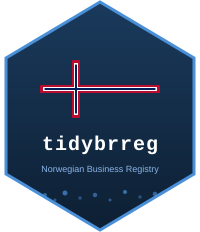

```{r, include = FALSE}
knitr::opts_chunk$set(
  collapse = TRUE,
  comment = "#>",
  fig.path = "man/figures/README-",
  out.width = "100%"
)
```

# tidybrreg 

<!-- badges: start -->
[](https://github.com/sondreskarsten/tidybrreg/actions/workflows/R-CMD-check.yaml)
[](https://lifecycle.r-lib.org/articles/stages.html#experimental)
<!-- badges: end -->

Tidy R interface to Norway's [Central Coordinating Register for Legal Entities](https://www.brreg.no/en/) (Enhetsregisteret), maintained by the Brønnøysund Register Centre. The register contains approximately 1 million active entities. Data is published under the [Norwegian Licence for Open Government Data (NLOD 2.0)](https://data.norge.no/nlod/en/2.0).

This repository holds three packages that are versioned and built together:

| Package | Directory | Purpose |
|---|---|---|
| **tidybrreg** | `/` | The typed client: fifteen functions, one per register endpoint. CRAN-bound. |
| **tidybrregpanel** | `tidybrregpanel/` | Managed state: Parquet snapshots, `brreg_sync()`, replay, changelog, flows, panels, series, networks, survival data. |
| **tidybrregmcp** | `tidybrregmcp/` | A Model Context Protocol server whose tools, schemas and documentation are derived from tidybrreg's exports and help pages. |
| **tidybrreg-mcp** | `tidybrreg-mcp-node/` | The same server without R: an npm package (`npx tidybrreg-mcp`) built from the manifest tidybrregmcp writes, for Claude, ChatGPT and OpenAI clients. |

## Installation

```{r install, eval = FALSE}
install.packages(c("tidybrreg", "tidybrregpanel", "tidybrregmcp"),
  repos = c("https://sondreskarsten.r-universe.dev",
            "https://cloud.r-project.org"))

# Or from GitHub
pak::pak("sondreskarsten/tidybrreg")
pak::pak("sondreskarsten/tidybrreg/tidybrregpanel")
pak::pak("sondreskarsten/tidybrreg/tidybrregmcp")
```

## Entity lookup

```{r entity, eval = FALSE}
library(tidybrreg)

brreg_entity("923609016")
#> # A tibble: 1 x 63
#>   org_nr    name        legal_form founding_date employees nace_1
#>   <chr>     <chr>       <chr>      <date>            <int> <chr>
#> 1 923609016 EQUINOR ASA ASA        1972-09-18        21408 06.100

# Sub-entities (establishments)
brreg_entity("974760843", registry = "underenheter")
```

Only observed fields are emitted; `registry` and `deleted` are always present. Codes by default. Translate with `type = "label"` or `brreg_label()`:

```{r label, eval = FALSE}
brreg_entity("923609016", type = "label")

brreg_entity("923609016") |>
  brreg_label(code = c("legal_form", "nace_1"))

brreg_label(c("AS", "ENK"), dic = "legal_form", lang = "no")
```

## Search

```{r search, eval = FALSE}
brreg_search(legal_form = "AS", municipality_code = "0301",
             min_employees = 500, max_results = 10)

# Sub-entity search
brreg_search(name = "Equinor", registry = "underenheter", max_results = 5)
```

A query that matches more than the register's 10,000-result window aborts with `tidybrreg_error_result_window` rather than returning a partial population; results carry `total_matches` and `complete` attributes.

## Roles, groups and signing authority

```{r roles, eval = FALSE}
brreg_roles("923609016")          # who holds roles IN an entity
brreg_roles_legal("923609016")    # roles an entity holds in OTHER entities
brreg_konsern("923609016")        # the corporate group tree
brreg_signatur("923609016")       # who may sign for the entity
brreg_prokura("923609016")        # procuration holders
```

## Incremental updates

```{r updates, eval = FALSE}
brreg_updates(since = "2026-03-01T00:00:00Z", size = 1000, max_pages = 10)
brreg_update_fields(since = Sys.Date() - 1)
brreg_updates(type = "roller", since = Sys.Date() - 1)
```

## Bulk downloads

```{r download, eval = FALSE}
entities     <- brreg_download(type = "enheter")                   # ~152 MB CSV
entities     <- brreg_download(type = "enheter", format = "json")  # ~196 MB JSON
sub_entities <- brreg_download(type = "underenheter")              # ~59 MB
roles        <- brreg_download(type = "roller")                    # ~131 MB JSON
path         <- brreg_download(type_output = "path")
```

## Validate organization numbers

```{r validate}
library(tidybrreg)
brreg_validate(c("923609016", "984851006", "123456789"))
```

## Design

**Codes by default, labels on demand.** Functions return Norwegian codes. `brreg_label()` translates to English or Norwegian via bundled reference data or live SSB KLASS lookups; `options(tidybrreg.offline = TRUE)` stays on the bundled dictionaries.

**Observed fields only.** A column is present when the register emitted the field; nothing is fabricated as `NA`. Unknown API fields pass through with auto-generated snake_case names (zero-drop policy).

**Typed conditions.** Every error and warning has a class and fields (`?tidybrreg_conditions`): deleted entities, partial or truncated results, result-window overflow, unknown feed members, bundled-dictionary fallback.

**One coercion rule.** Dictionary types are identical on the live JSON path and the bulk CSV/JSON path; parse failures are reported, never fatal.

**UTC instants.** Feed timestamps and HTTP dates are UTC `POSIXct` whatever the session time zone.

## Functions

| Function | Description |
|---|---|
| `brreg_entity()` | Single entity by organization number (enheter or underenheter) |
| `brreg_search()` | Filtered search (enheter or underenheter) |
| `brreg_underenheter()` | Sub-units of an entity |
| `brreg_children()` | Children in the ORGL administrative hierarchy |
| `brreg_roles()` | Board members, officers, auditors for an entity |
| `brreg_roles_legal()` | Reverse: roles an entity holds in other entities |
| `brreg_konsern()` | Corporate group structure |
| `brreg_signatur()` | Signature authority |
| `brreg_prokura()` | Procuration |
| `brreg_updates()` | Incremental change stream (enheter, underenheter, roller) |
| `brreg_update_fields()` | Flat field-level changes |
| `brreg_download()` | Full register bulk download (enheter, underenheter, roller) |
| `brreg_label()` | Translate codes to descriptions |
| `get_brreg_dic()` | Fetch/cache NACE or sector dictionaries |
| `brreg_validate()` | Organization number validation (modulus-11) |

## MCP server

`tidybrregmcp` serves these fifteen functions to any Model Context Protocol client. Tool names are the function names and the descriptions are the help pages, so the server changes exactly when this package changes.

```json
{"mcpServers": {"tidybrreg": {"command": "Rscript", "args": ["-e", "tidybrregmcp::mcp_serve()"]}}}
```

Without R, from npm:

```json
{"mcpServers": {"tidybrreg": {"command": "npx", "args": ["-y", "tidybrreg-mcp"]}}}
```

See `tidybrregmcp/README.md` and `tidybrreg-mcp-node/README.md`.

## License

MIT. Data from Enhetsregisteret is available under [NLOD 2.0](https://data.norge.no/nlod/en/2.0) and must be attributed to the Brønnøysund Register Centre; see `?tidybrreg_provenance` for the sources of the bundled tables.
